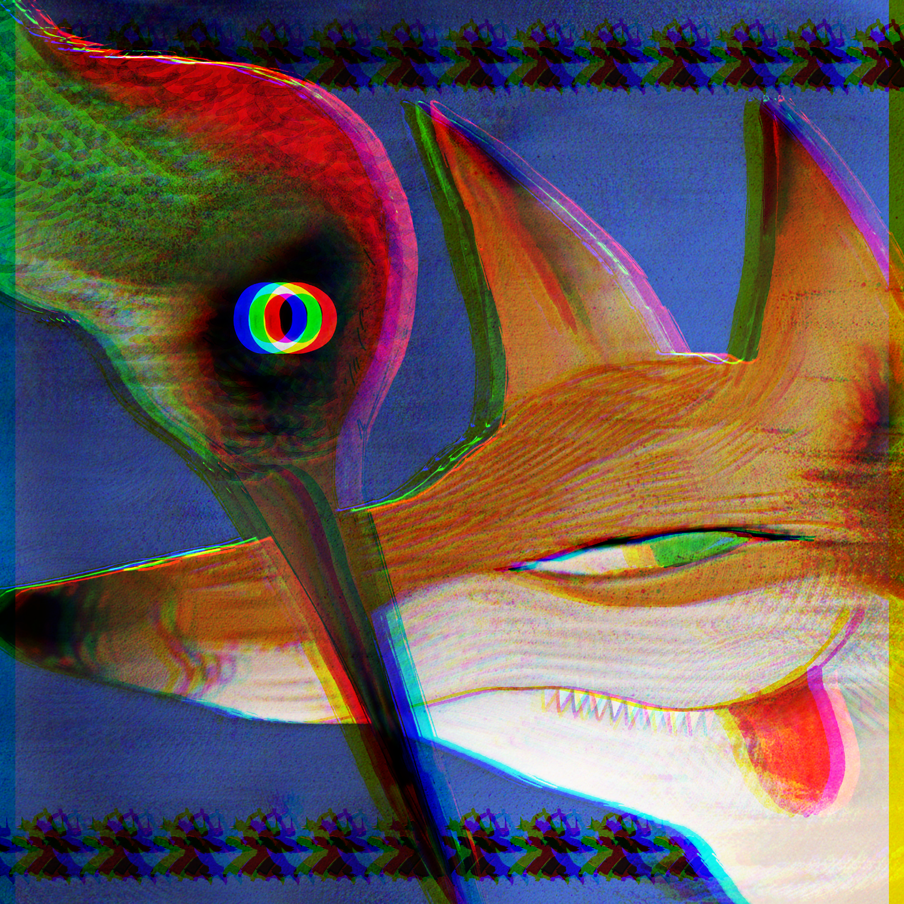

# SUPER COMPUTER GRAPHICS - Workshop S1 IMAC

Workshop de programmation consistant à coder des filtres pour des images (comme on peut en trouver dans Photoshop, les filtres Instagram, etc.), générer des formes, les animer, le tout réalisé en C++. 

## Exemples 

