# SUPER COMPUTER GRAPHICS - Workshop IMAC S1

Cet exercice de programmation consiste à coder des filtres pour des images (comme on peut en trouver dans Photoshop, les filtres Instagram, etc.), générer des formes, les animer, le tout réalisé en C++. 

 🔗 **Sujet d'origine :** [Workshop IMAC - Introduction à la synthèse d'images](https://dsmte.github.io/Learn--cpp_programming/Workshop/Sujet)

> [!NOTE]
> Les étoiles (⭐) représentent le niveau de difficulté pour coder chaque effet. Le sujet d'origine contient des exercices allant jusqu'à six étoiles (⭐⭐⭐⭐⭐⭐).


> [!NOTE]
> Mon projet n'existe pas sous forme de logiciel, je le fais tourner uniquement depuis mon IDE VSCode. Donc pas d'exécutable utilisable par le grand public pour l'instant (même si vous pouvez toujours cloner le repo GitHub et exécuter le code vous-mêmes)!


## ⭐

### Garder un seul canal


### Channel swap

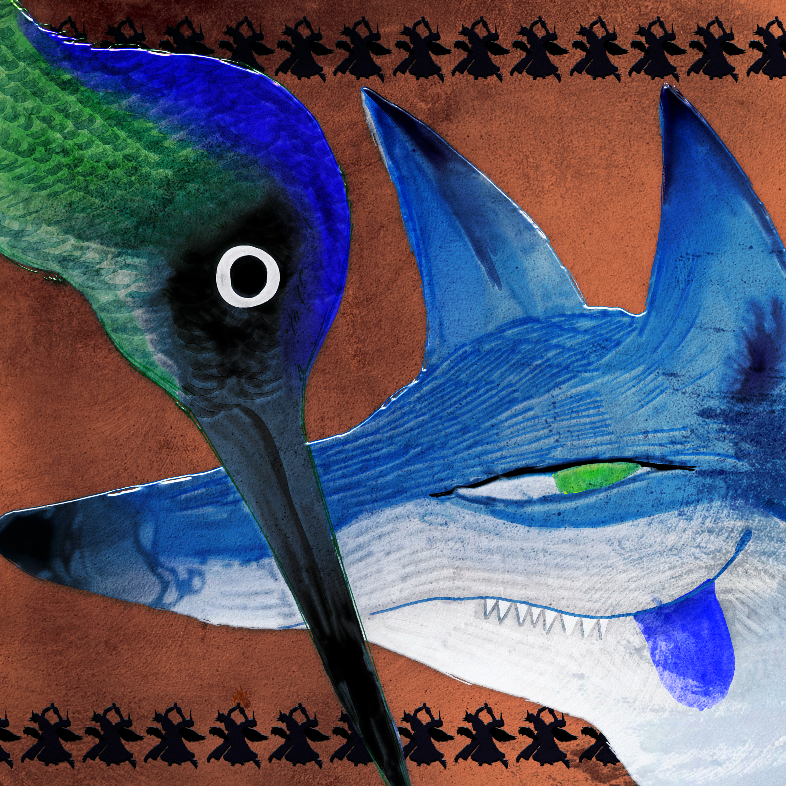

### Greyscale

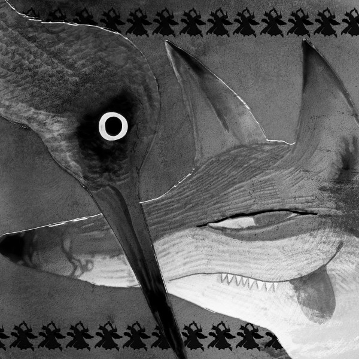

### Invert


### Genérer un gradient

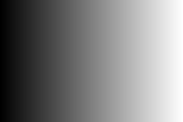


## ⭐⭐

### Miroir
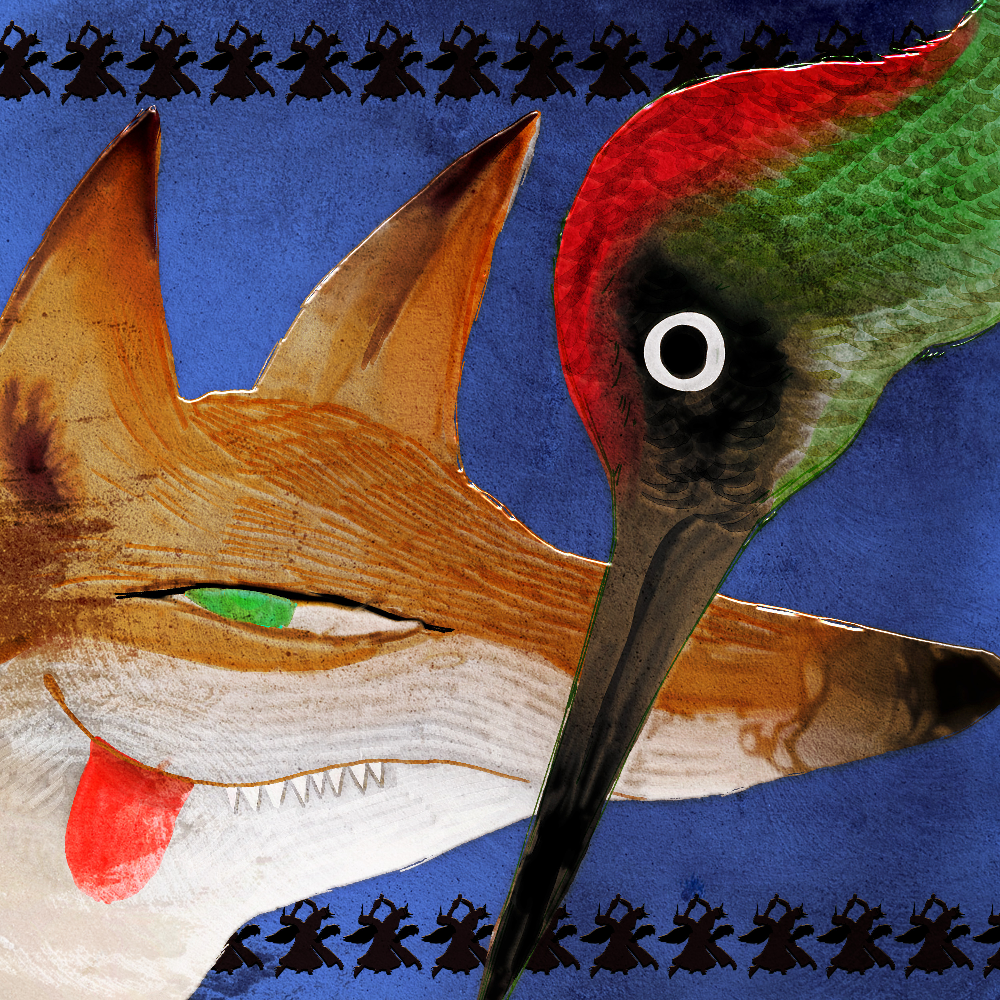


### Noise


```c++
image.pixel(x, y) = glm::vec3{
    random_float(0, 1),
    random_float(0, 1),
    random_float(0, 1)
};
```

permet un bruit coloré, tandis que : 

```c++
image.pixel(x, y) = glm::vec3{random_float(0, 1)};
```
rend le bruit en nuances de gris (vu qu'on a une valeur pour tous les channels).

### White noise


Cette fois-ci au lieu d'agir aléatoirement sur certains pixels on agit sur TOUS les pixels, en modifiant leur valeur au lieu de la remplacer.

*(Pour l'instant j'ai réussi à faire que ça en greyscale au vu de la facilité de modifier une seule valeur **brightness** pour chaque pixel)*


### Rotation à 90°

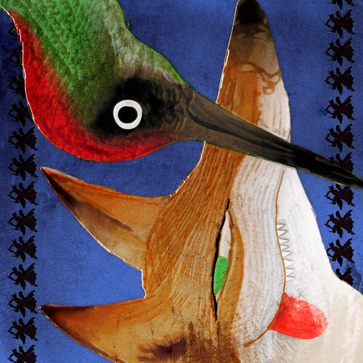

Au lieu de parcourir la moitié sur l'axe y on parcourt la moitié sur la diagonale, après j'avoue c'était beaucoup de tâtonnements pour trouver la formule. Je vois bien qu'il y a une translation intelligente qui se fait à partir de la formule, mais visuellement c'est difficile de me le représenter.

### RGB Split

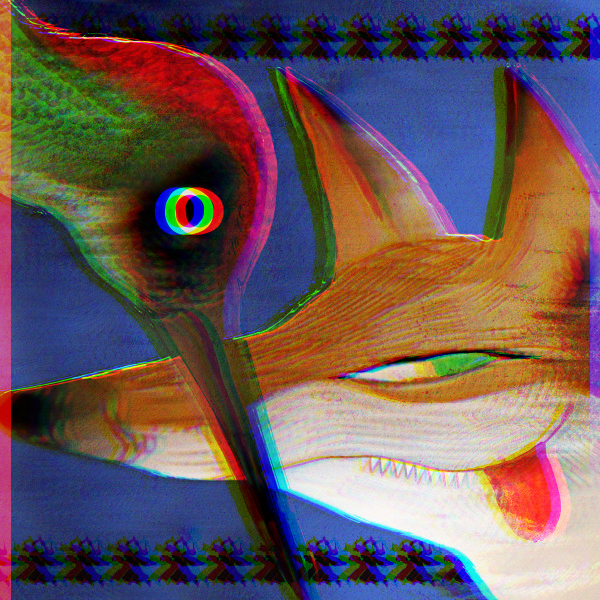

### Luminosité

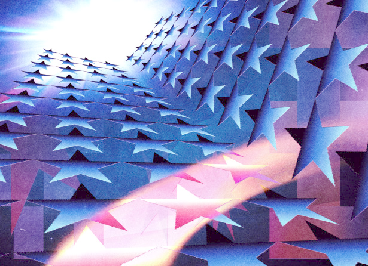
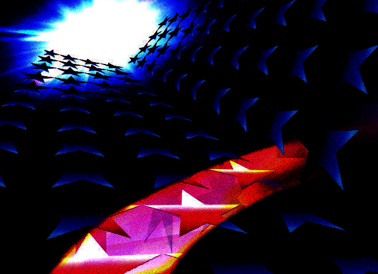

### Disque

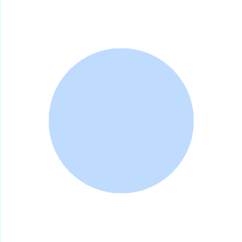

```c++
double disk_equation {(std::pow(x - centerx, 2) + std::pow(y - centery, 2))};

if (disk_equation <= std::pow(radius, 2)) {
    image.pixel(x, y) = glm::vec3{0};
}
```

En français, ça veut dire qu'on trace uniquement nos pixels du disque si les dits pixel se trouvent dans l'équation d'un disque : 

$$(x - x_0)^2 + (y - y_0)^2 \le r^2$$


### Cercle
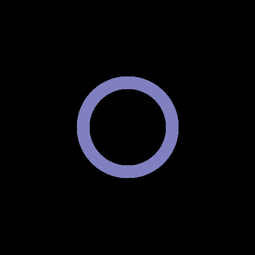

On ajoute un paramètre d'épaisseur, qui s'obtient simplement en rajoutant une nouvelle condition à notre code d'origine :

```c++
if (std::pow(radius - thickness, 2) <= disk_equation && disk_equation <= std::pow(radius, 2)) {
                image.pixel(x, y) = glm::vec3{0};
            }
```

Ma fonction admet plusieurs paramètres pour changer la position du cercle, son rayon et son épaisseur de contours, ce qui s'avère très utile pour modifier les propriétés du cercle en fonction du temps !

```c++
void circle(sil::Image& image, int centerx, int centery, int radius, int thickness)
{
    for (int x{0}; x<image.width(); x++)
    {
        for (int y{0}; y<image.height(); y++)
        {
            double disk_equation {(std::pow(x - centerx, 2) + std::pow(y - centery, 2))};

            if (std::pow(radius - thickness, 2) <= disk_equation && disk_equation <= std::pow(radius, 2)) {
                image.pixel(x, y) = glm::vec3{0};
            }
        }
    }
}
```

### Animer le disque


Onreprend le disque, mais en plus de modifier la position du cercle en fonction du temps, j'ai également appliqué un filtre rgbsplit qui augmente en fonction du temps (avec une boucle *for* au moment d'appeler les fonctions, dont je précise le fonctionnement plus bas dans le rapport), et qui remplace le canal vert par une couleur légèrement différente, donnant un rendu super intéressant!!

### mosaique
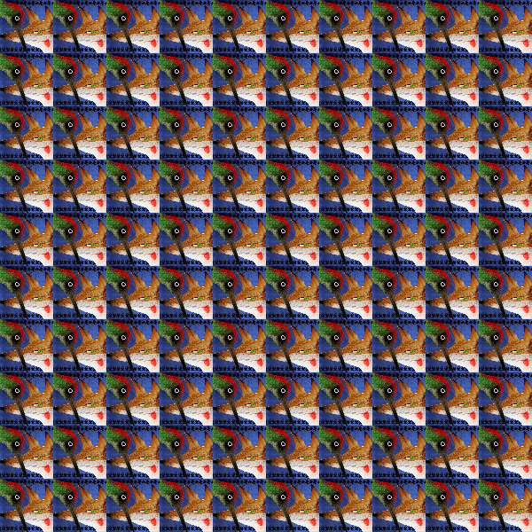

On répète une image en plusieurs fois, ce qui ici peut prendre plus de temps que prévu en temps de rendu si l'on n'intègre pas cette portion de fonction : 

```c++
sil::Image final_image{image.width(), image.height()}; 

for (int x{0}; x < final_image.width(); x++)
{
    for (int y{0}; y < final_image.height(); y++)
    {
        final_image.pixel(x, y) = new_image.pixel(x*tiles, y*tiles);
    }
}

image = final_image;
```

Ces lignes permettent de redimensionner l'image à sa taille d'origine, puisque la mosaique répète l'image et augmente donc la taille du rendu (Si la taille d'origine est de 600px, et qu'on répète l'image 10 fois, la taille finale sera de 600 x 10 = 6000px, d'où le besoin de la rétrécir après coup).


## ⭐⭐⭐

### rosace


```c++
void rosace(sil::Image& image, int roscenterx, int roscentery, int rosradius, int thickness)
{
    circle(image, roscenterx, roscentery, rosradius, thickness);

    for(float angle{0}; angle <= (5*M_PI/3); angle += M_PI/3){
        double centerx {(roscenterx + (cos(angle)*rosradius))};
        double centery {(roscentery + (sin(angle)*rosradius))};  
        
        circle(image, centerx, centery, rosradius, thickness);
    }
}
```

J'ai juste répété la fonction `circle` en changeant le centre du cercle, mais du coup je me suis rendu compte avec ça que je peux empiler les fonctions pour créer des compositions si je voulais vraiment, ajouter un filtre mosaïque, faire des animations, augmenter la taille du cercle au fil du temps, etc.


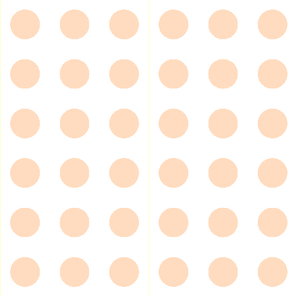


## ⭐⭐⭐⭐

### mosaïque miroir

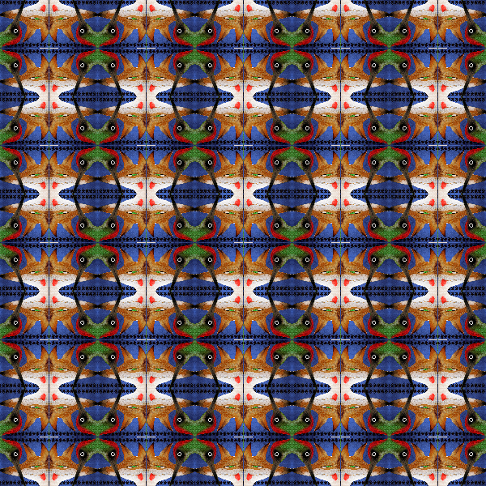

### dithering


Le dithering, ou tramage, consiste à calculer la valeur de couleur d'un pixel en fonction d'un objet mathématique bien spécifique appelé matrice de Bayer. C'est essentiellement un tableau de nombres aux valeurs précises et définies par cette équation (pour les curieux) : 

$$
M_{2n} = \begin{pmatrix}
4M_n & 4M_n + 2J_n \\
4M_n + 3J_n & 4M_n + J_n
\end{pmatrix}
$$

À partir de ce tableau de nombres, et en appliquant un effet de seuil (qui convertit tous les pixels de couleurs en noir ou blanc uniquement), on obtient alors ce rendu si caractéristique !

En modifiant les valeurs de couleur de mon threshold (donc au lieu de juste convertir mes pixels en noir ou blanc mais en d'autres couleurs) j'obtiens des palettes de couleurs différentes :


En empilant les filtres, comme ici avec un filtre mosaïque miroir, on obtient aussi des choses comme ça :


Sur ce gif, j'ai fait varier la valeur des couleurs de départ et d'arrivée de mon threshold au fil du temps!

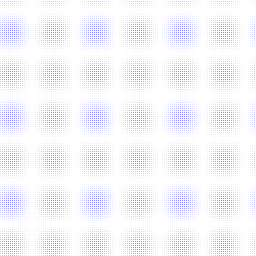

```c++
for (int x{1}; x < 450; x++){
    sil::Image image{500, 500};
    background(image);
    rosace(image, image.width()/2, image.height()/2, 1+x, 15+x/5); 
    mosaic_mirror(image, 6);
    dither(image);
    threshold(image, 0.5, 1-(x/450.f), 1-(x/450.f), 1, 0.5+(x/900.f), 0.5-(x/900.f), 1-(x/450.f));
    std::stringstream stream;
    stream << "output/anim3/anim_" << x << ".png";
    image.save(stream.str());
}
```
Pour expliquer plus précisément le processus d'animation : il suffit d'utiliser une boucle `for` pour itérer la génération d'image. On applique les filtres qu'on veut (en l'occurence du dithering et une mosaïque miroir), puis on renomme à chaque fois l'image de sortie avec notre index `x` pour ne pas les écraser.  J'ai ensuite récupéré toutes les frames et en j'en ai fait le .gif que vous voyez plus haut via un site web de création de gifs ! 

### Diamond square (raté)


J'ai réussi à créer la formule basique (calculer les milieux + diamants), sans pour autant avoir réussi à boucler correctement le processus pour compléter l'image, et sans confirmation que les valeurs d'altitudes soient correctes, faute de temps (et d'énergie). Je m'avoue vaincu pour cette fois !


