# Rapport du workshop

## ⭐

### swap channels

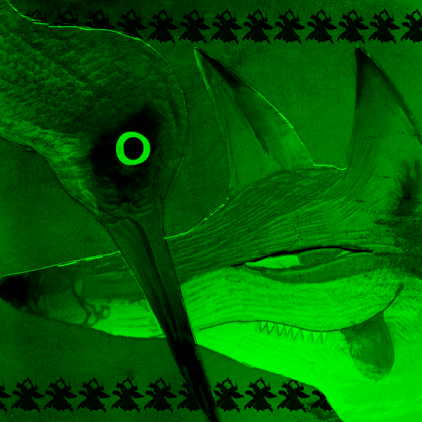

```
tmp = color.r;
color.r = color.b;
color.b = tmp;
```

J'ai fait une variable tmp avant de voir que y'avait la fonction native swap, soit.

### channel swap

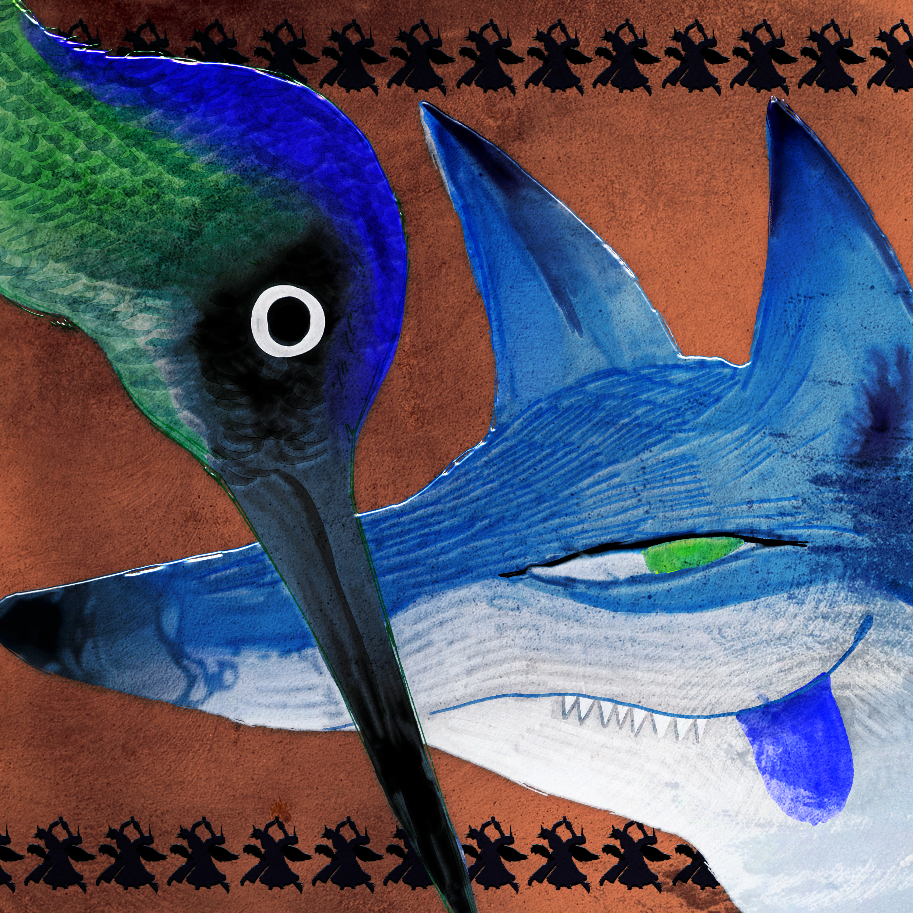

### noir et blanc

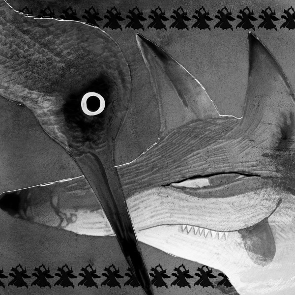

On fait une moyenne de chaque canal et on l'assigne cette moyenne à tous les canaux parce que les gris ont toujours des valeurs de canaux égales (genre 12 12 12 ou 123 123 123).

### inverser

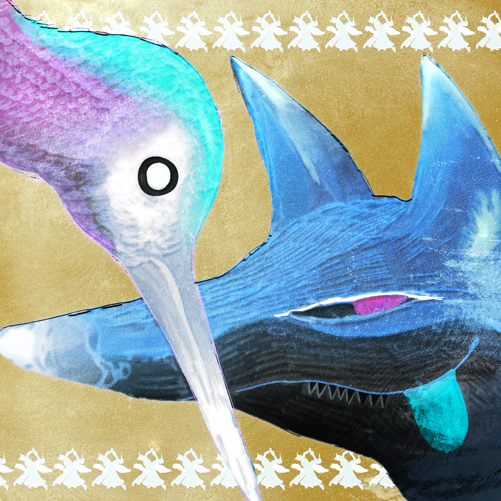

OK c'est greg qui m'a donné la solution je sais pas pourquoi j'avais pas pensé à faire 1 - la valeur du channel.

### gradient


## ⭐⭐

### miroir
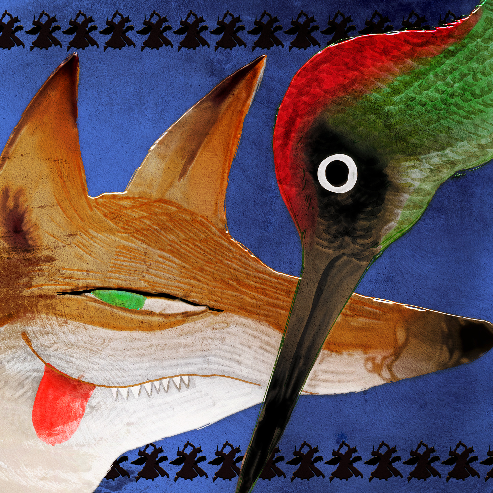


### noise

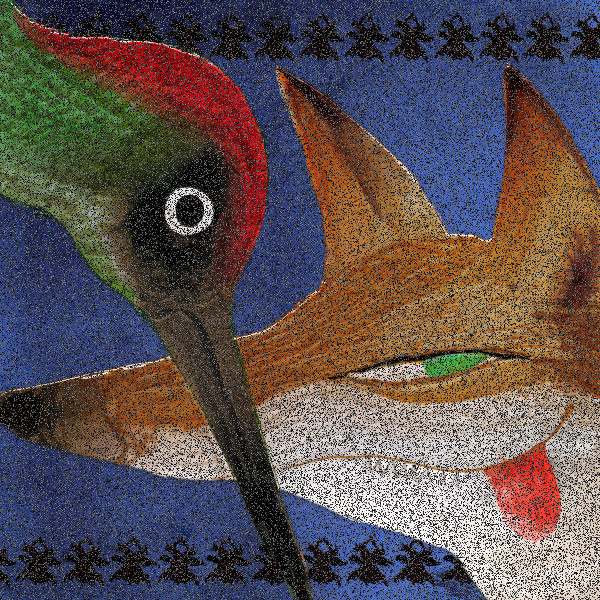

```
image.pixel(x, y) = glm::vec3{
    random_float(0, 1),
    random_float(0, 1),
    random_float(0, 1)
};
```

permet un bruit coloré, tandis que : 

```
image.pixel(x, y) = glm::vec3{random_float(0, 1)};
```
rend le bruit en nuances de gris (vu qu'on a une valeur pour tous les channels).

### white noise


Cette fois-ci au lieu d'agir aléatoirement sur certains pixels on agit sur TOUS les pixels, en modifiant leur valeur au lieu de la remplacer.

*(Pour l'instant j'ai réussi à faire que ça en greyscale au vu de la facilité de modifier une seule valeur **brightness** pour chaque pixel)*


### rotation 90

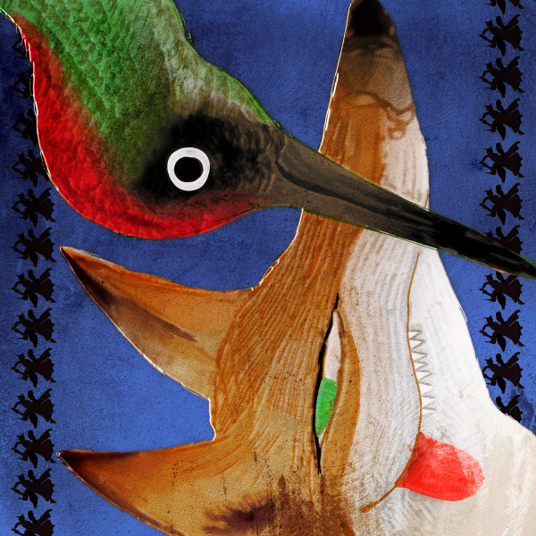

Au lieu de parcourir la moitié sur l'axe y on parcourt la moitié sur la diagonale, après j'avoue c'était beaucoup de tâtonnements pour trouver la formule. Je vois bien qu'il y a une translation intelligente qui se fait à partir de la formule, mais visuellement c'est difficile de me le représenter.

### rgbsplit

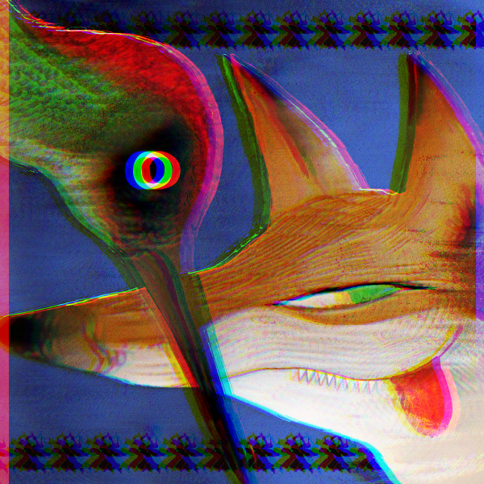

### cercle
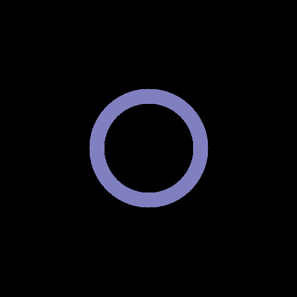

Ma fonction admet plusieurs paramètres pour changer la position du cercle, son rayon et son épaisseur de contours, ce qui s'avère très utile pour modifier les propriétés du cercle en fonction du temps !

```
void circle(sil::Image& image, int centerx, int centery, int radius, int thickness)
{
    for (int x{0}; x<image.width(); x++)
    {
        for (int y{0}; y<image.height(); y++)
        {
            double disk_equation {(std::pow(x - centerx, 2) + std::pow(y - centery, 2))};

            if (std::pow(radius - thickness, 2) <= disk_equation && disk_equation <= std::pow(radius, 2)) {
                image.pixel(x, y) = glm::vec3{0};
            }
        }
    }
}
```

### mosaique
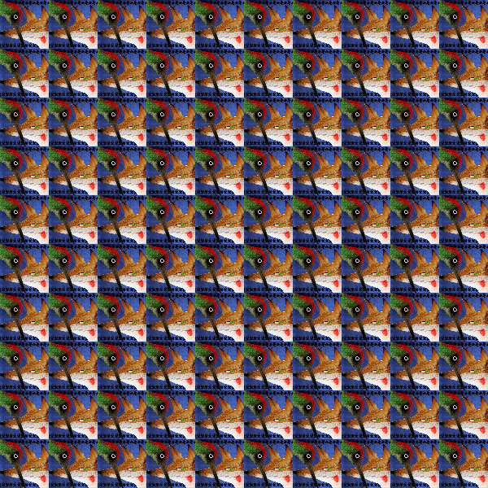

```
sil::Image final_image{image.width(), image.height()}; 

for (int x{0}; x < final_image.width(); x++)
{
    for (int y{0}; y < final_image.height(); y++)
    {
        final_image.pixel(x, y) = new_image.pixel(x*tiles, y*tiles);
    }
}

image = final_image;
```


Un morceau de la fonction permet de resize l'image à sa taille d'origine, puisque la mosaique répète l'image et augmente donc la taille du rendu (Si la taille d'origine est de 300px, et qu'on répète l'image 5 fois, la taille finale sera de 300 x 5 = 1500px, d'où le besoin de la rétrécir après coup).

### anim de cercle


En plus de modifier la position du cercle en fonction du temps, j'ai également appliqué un filtre rgbsplit qui augmente en fonction du temps (avec une boucle *for* au moment d'appeler les fonctions), et qui remplace le canal vert par une couleur légèrement différente, donnant un rendu assez intéressant!!

## ⭐⭐⭐

### disque

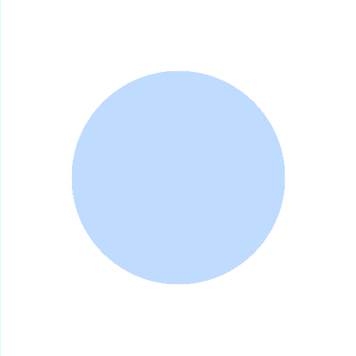

### rosace

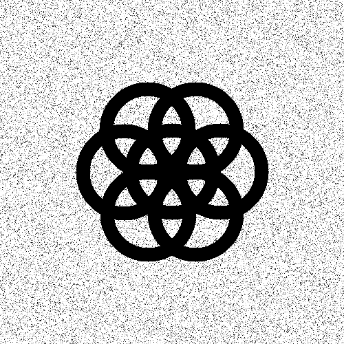


```
void rosace(sil::Image& image, int roscenterx, int roscentery, int rosradius, int thickness)
{
    circle(image, roscenterx, roscentery, rosradius, thickness);

    for(float angle{0}; angle <= (5*M_PI/3); angle += M_PI/3){
        double centerx {(roscenterx + (cos(angle)*rosradius))};
        double centery {(roscentery + (sin(angle)*rosradius))};  
        
        circle(image, centerx, centery, rosradius, thickness);
    }
}
```

en fait j'ai juste répété la fonction cercle en changeant le centre du cercle, mais du coup je me suis rendu compte avec ça que je peux empiler les fonctions pour créer des compositions si je voulais vraiment, ajouter un filtre mosaïque, faire des animations, augmenter la taille du cercle au fil du temps, etc.

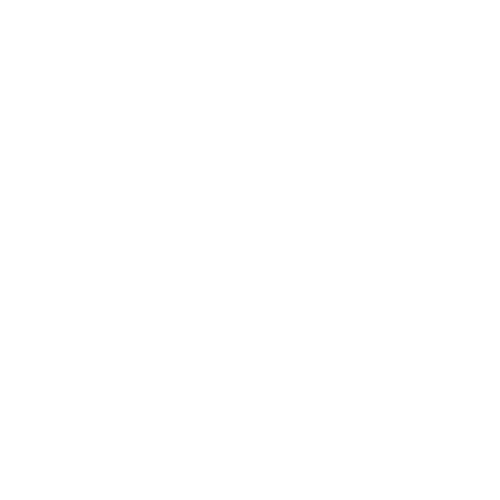

## ⭐⭐⭐⭐

### mosaïque miroir

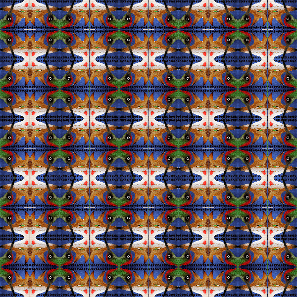

### dithering

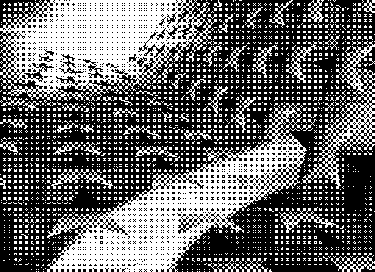

En modifiant les valeurs de mon threshold je peux avoir une palette de couleurs différente :

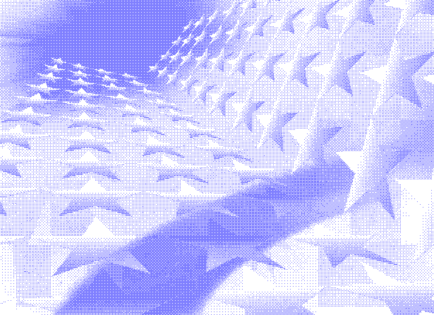;
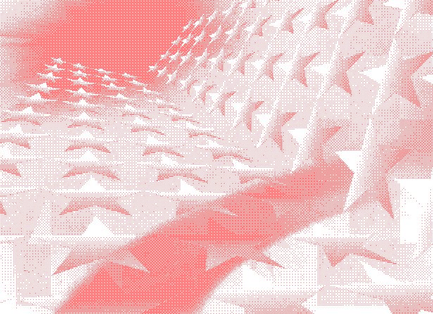;

Ou même le mélanger à un filtre mosaïque miroir par exemple ! Ou faire plein d'autres mélanges

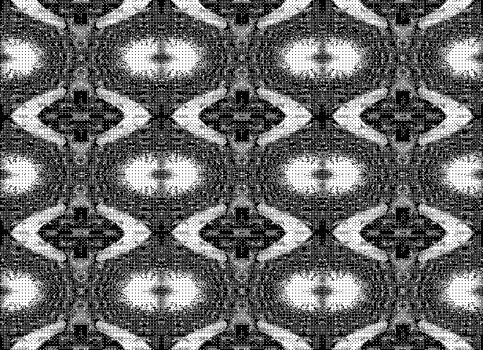;
;


